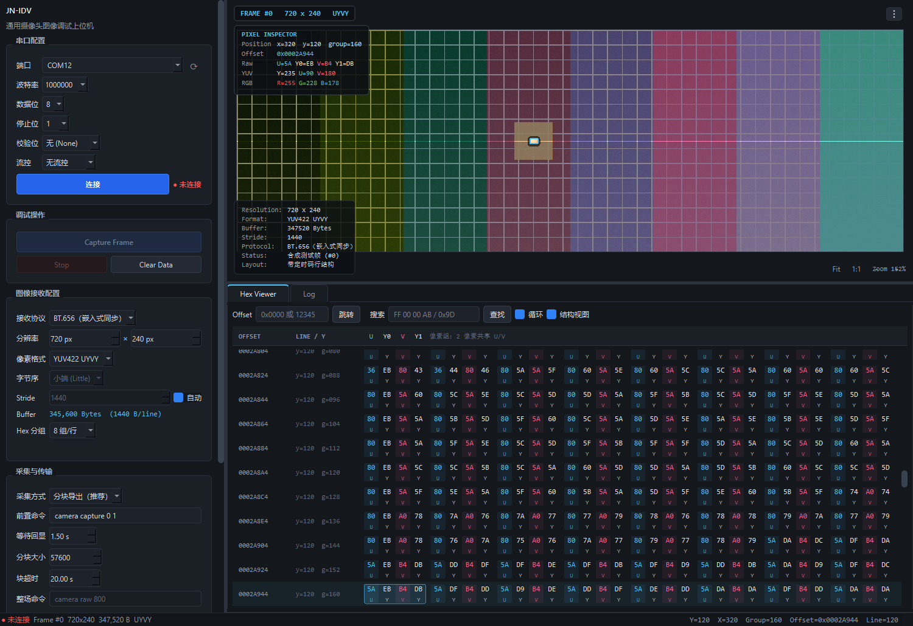
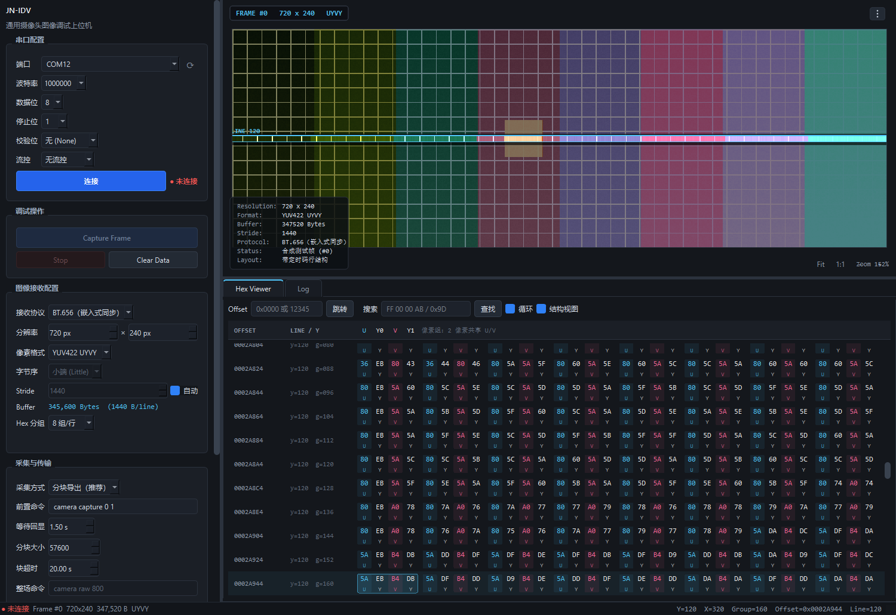
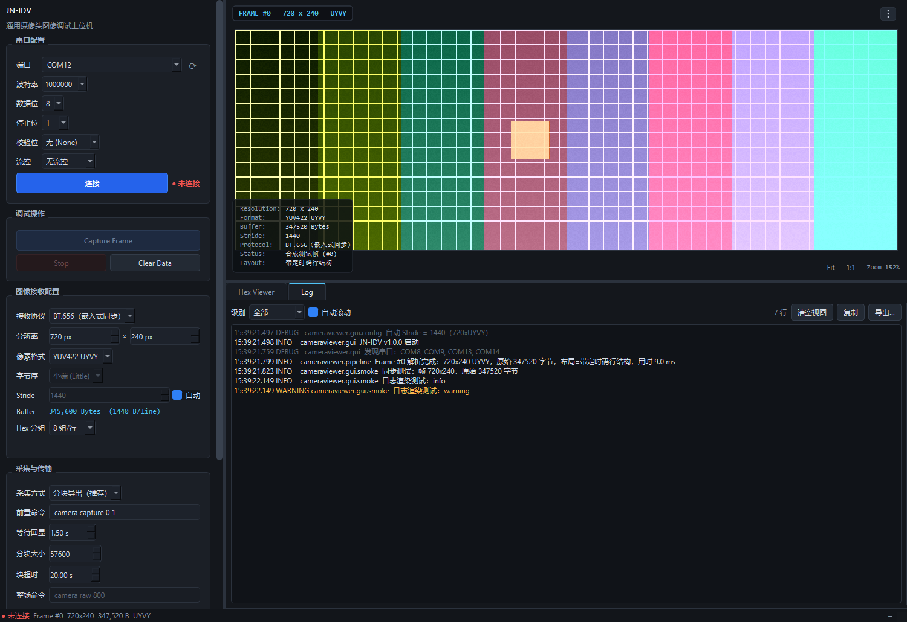

# JN-IDV · Camera Image Debug Viewer

English | [简体中文](README_zh.md)

> **JN-IDV** is the repository *and* application name (short for *Image Debug Viewer*); the descriptive long name is *Camera Image Debug Viewer*. The window title, log banner and CLI header all use `JN-IDV`.

A general-purpose image debugging host application for embedded cameras. It currently ships a BT.656 / YUV422 capture-and-parse pipeline built around the workflow "send a command over the serial port → the device returns a raw buffer → decode it into an image → inspect it row by row and pixel by pixel".

**It is neither a plain serial terminal nor a generic camera preview tool**: it maintains an exact coordinate mapping between the raw bytes, the BT.656 line structure, the pixel groups and the final image. Serial I/O, image decoding, hex organization and file export all live in `core/`, shared by both the GUI and the CLI.




## 1. Features

| Capability | Description |
|---|---|
| Serial configuration | Port scan / manual entry, baud rate, data bits, stop bits, parity, flow control; connection failures show the real reason |
| Image parameters | Protocol, width/height, pixel format (UYVY / YUYV / YVYU / VYUY / RGB565 / RGB888 / JPEG), stride, byte order, buffer size, hex grouping |
| Capture flow | One-click `Capture Frame`; chunked dump (57600 B per chunk by default) or a whole-frame command; Stop, timeouts, CRC/length validation, chunk reassembly |
| Image Preview | Fit / 1:1 / wheel zoom, nearest-neighbour upscaling, pixel inspector; "extract and magnify" animation at both row and pixel-group level |
| Hex Viewer | Rows / SAV / EAV / pixel groups; U/Y/V colour coding; offset jump, hex search, copy, structured vs. plain hex |
| Two-way linking | Hovering a row in the Hex view highlights the whole row in the image; hovering the image scrolls the Hex view to the matching row and highlights it |
| Export | Single three-dot menu in the top-right corner: PNG, JPG, raw buffer, structured hex, frame metadata JSON, complete debug session |
| Device-side sample code | One-click copy / export of C sources and headers generated from the current parameters (generic UART chunked-upload frame format) |
| Log | Real `logging` output (file and UI share one source), level filtering, pause auto-scroll, copy, export |
| CLI | Agent automation: capture, offline decode, structure analysis, hex export, sample-code generation, synthetic test data |
| Extensible architecture | Adding a pixel format, a capture protocol or a display format does not require touching the GUI shell |

## 2. Quick start

### 2.1 Environment

```powershell
conda activate kbhost
cd JN-IDV                       # or your local checkout directory name
python main.py
```

To reinstall dependencies on another machine:

```powershell
pip install -r requirements.txt
# Optional: install Pillow if Qt is unavailable when decoding JPEG
pip install pillow
```

### 2.2 First capture

1. In **Serial Configuration** (left panel), pick the port and baud rate (default `1000000`).
2. Click **连接** (Connect); the status bar turns green.
3. Check **Image Receive Configuration**: width/height, pixel format, stride, buffer size.
4. Enter the commands your device actually uses under **Capture & Transfer**:
   - Prepare command example: `camera capture 0 1`
   - Chunked dump template: `camera dump {off} {len}`
   - Whole-frame command example: `camera raw 800`
   > These are placeholder examples only. Every device has different commands — just edit them in the UI; they are saved to the local configuration. The companion firmware side already registers the generic `camera capture` / `camera dump` / `camera raw` / `camera info` command set.
5. Click **Debug Actions → Capture Frame**.
6. The capture flow:
   - Send the prepare command so the device captures one frame;
   - Send the dump command in `57600`-byte chunks;
   - For every chunk validate the 64-byte header, CRC32 and 4-byte tail, then reassemble the whole frame by `total/offset`;
   - Parse the BT.656 layout, decode the pixel format, build a `Frame`;
   - Image Preview shows the real image, and Hex Viewer / Log become available.

No board required either: top-right menu → **Load raw buffer (.bin)…**, or simply drag a `.bin` file into the window.

### 2.3 Interaction cheat sheet

- Image Preview: wheel zoom (centred on the cursor), drag to pan, double-click to fit; `Fit` / `1:1` / `−` / `+` at the bottom-right.
- Hex Viewer: hovering a row highlights the whole image row; hovering a specific pixel group / byte highlights the matching pixel group in the image and opens the Pixel Inspector.
- Moving the mouse over the image scrolls the Hex view to the matching row and highlights it; clicking a pixel keeps that pixel group selected in the Hex view.
- Hex toolbar: `Offset` jump, `搜索` (Search, e.g. `FF 00 00 AB`; accepts `0x`, spaces and commas), `循环` (wrap-around), `结构视图` (structured view) toggle.
- Hex context menu: copy the current pixel-group bytes / the current row as hex / the current row as a C array / the offset / row info / search for this byte.
- Top-right three-dot menu: entry point for every export and for the device-side sample code.

## 3. User interface

The data area on the right is split vertically:

- **Top half**: a dedicated Image Preview, always visible;
- **Bottom half**: two tabs, Hex Viewer and Log;
- The splitter between them can be dragged to resize the image and hex areas (the ratio is remembered).


### 3.1 Image Preview



- The original image layer never changes; row/pixel highlighting is a drawing overlay only and never mutates `frame.image` or `frame.raw_data`.
- Row highlight: the rest of the image is dimmed, while the current row is animated slightly larger with a shadow and border.
- Pixel-group highlight: the whole row returns to normal brightness, while the current YUV422 macro-pixel group (two pixels sharing U/V) is magnified on its own, with a thin line separating the two luma pixels.
- Bottom-left status: Resolution / Format / Buffer / Stride / Protocol / Status / Layout — all taken from the real `Frame`.
- When a pixel is highlighted, the Pixel Inspector appears at the top-left: Position, Buffer Offset, raw U/Y/V bytes, YUV, RGB.

### 3.2 Hex Viewer


- Organized as `LINE → SAV → Pixel Group → EAV`; without timing codes rows are split by stride, and the Log / row info says so.
- Each byte cell shows the hex value and the component letter; U is cyan, Y white, V pink, SAV/EAV orange.
- Pixel groups are displayed four cells at a time as `U0 Y0 V0 Y1`, making it explicit that U/V are shared by two adjacent pixels, so two pixels are never mistaken for two complete YUV triplets.
- The row header shows row number, active/blank, field, data length and the corresponding image row; the row footer shows `image row N`.
- Any timing code that leaked into the capture buffer is shown on its own at the matching offset instead of being mixed into a pixel group.

### 3.3 Log



- Shares a single `logging` source with `core.log`: serial parameters, TX/RX, receive progress, byte counts, integrity checks, parsing time, export records and exceptions all land here.
- **清空视图** (Clear view) only clears the widget; it does not touch the file log or the underlying logging setup.
- Supports level filtering, pausing auto-scroll (uncheck the box), copy and export to `.txt`.
- Log files are written to `logs/camera_viewer_YYYYmmdd_HHMMSS.log`.

## 4. Serial protocol

The host uses a generic "64-byte header + payload + 4-byte tail" chunked-upload format. The device only needs to reply in this format; the commands themselves are configured by the user in the UI, and the tool is not tied to any device.

```text
offset  size  field
0       4     sync = A5 5A A5 5A
4       1     ver = 1
5       1     flags (bit0 raw / bit1 interlaced / bit2 PAL / bit3 short frame)
6       2     hdr_len = 64
8       4     state0   device state snapshot 0 (optional, may be 0)
12      4     state1   device state snapshot 1
16      4     state2   device state snapshot 2
20      4     state3   device state snapshot 3
24      4     state4   device state snapshot 4
28      4     total    total bytes of the whole frame
32      4     offset   offset of this packet within the frame
36      4     length   payload length of this packet
40      4     ms
44      4     flags2
48      4     crc_hdr = CRC32(bytes[8..47])
52      4     crc_data= CRC32(payload)
56      8     reserved
64      N     payload
64+N    4     tail = 5A A5 5A 5A
```

`crc32` is the standard CRC-32 (poly `0xEDB88320`, identical to `zlib.crc32`).

`state0..state4` are diagnostic only and never participate in parsing; the device may fill them all with 0.

### 4.1 Capture state machine

```text
User clicks Capture Frame
  → CaptureWorker(QThread)
  → CaptureEngine.run()
      → if a prepare command is configured: send it, wait for the echo and detect failure keywords
      → chunked mode: send the dump command, let FrameParser parse incrementally
      → validate offset/length/total/CRC/TAIL for every chunk; fail immediately on mismatch
      → once everything has arrived, join the chunks into the full payload
  → build_frame(): BT.656 layout + active-row extraction + pixel-format decoding
  → build_structured(): organize the hex display data by row / pixel group
  → the main thread receives (Frame, StructuredData) and updates the image above and Hex / Log below
```

Key guarantees:

- A single serial `read()` is never treated as a complete image; `FrameParser` must find a valid frame first.
- Leftover bytes from the previous frame never leak into the next one: `reset_input_buffer()` runs before each chunk is sent and the parser is reset per chunk.
- The Capture button is disabled while capturing; Stop is signalled through a `threading.Event` checked every 50 ms.
- Timeouts, length anomalies, CRC errors and serial disconnects are all written to the Log with the real cause and surfaced in a dialog.

## 5. Directory layout

```text
JN-IDV/
├── main.py                     # GUI entry point
├── cli.py                      # CLI entry point (agent automation)
├── requirements.txt
├── README.md                   # Default documentation (English)
├── README_zh.md                # Chinese documentation
├── SKILL.md                    # Handbook for follow-up agents / contributors
├── core/                       # Qt-independent core logic
│   ├── config.py               # SerialConfig / ImageConfig / CaptureConfig
│   ├── log.py                  # logging setup
│   ├── protocol/               # generic 64B frame protocol, incremental parser, protocol registry
│   ├── serial/                 # pyserial wrapper, port enumeration
│   ├── acquisition/            # capture engine (chunked / whole / cancel / timeout)
│   ├── formats/                # pixel format definitions, BT.656 layout and coordinate mapping
│   ├── image/                  # Frame object, per-format decoders
│   ├── hex/                    # structured hex data organization (DataFormatter)
│   ├── export/                 # PNG/JPG/Raw/Hex/Metadata/Session export
│   ├── device_template.py      # device-side upload C code generator
│   └── pipeline.py             # buffer → layout → decode → Frame pipeline
├── gui/
│   ├── main_window.py
│   ├── theme.py                # dark theme
│   ├── focus.py                # ViewFocus (shared coordinate object for image and hex)
│   ├── log_bridge.py           # logging → Qt signals
│   ├── panels/
│   │   ├── config_panel.py
│   │   ├── image_viewer.py
│   │   ├── hex_viewer.py
│   │   ├── log_viewer.py
│   │   └── export_menu.py
│   └── workers/                # CaptureWorker / BuildFrameWorker / CommandWorker
├── tests/                      # 82 unittests + GUI smoke test
├── docs/screenshots/           # README screenshots
├── out/                        # default export directory (populated at runtime)
└── logs/                       # log files (populated at runtime)
```

## 6. Architecture and data flow

```text
                    ┌─────────────────────────────┐
                    │          core/              │
                    │  serial → protocol →        │
                    │  acquisition → pipeline →   │
                    │  decoders / bt656 / hex     │
                    │  export / device_template   │
                    └──────────┬──────────────────┘
                               │
              ┌────────────────┴────────────────┐
              │                                 │
        ┌─────▼─────┐                     ┌─────▼─────┐
        │    GUI    │                     │    CLI    │
        │ manual    │                     │ agent     │
        │ debugging │                     │ debugging │
        └───────────┘                     └───────────┘
```

Three layers of responsibility:

1. **Capture protocol**: `core.protocol` + `core.acquisition` — how the device is asked to send data and how a frame is known to be complete.
2. **Image data format**: `core.formats.bt656` + `core.image.decoders` — sync structure, active region, pixel-format decoding.
3. **Raw-data display format**: `core.hex.formatter` — organizes the buffer into rows / pixel groups; the GUI only draws it.

`Frame` holds everything in one place: the full raw buffer, decoded RGB, luma/YUV planes, width/height, format, protocol, frame index, timestamp, protocol header, parse parameters, BT.656 layout and coordinate mapping. The raw buffer is **never discarded** after the image has been decoded.

## 7. Coordinate mapping

BT.656 data may contain SAV/EAV codes, blanking regions and end-of-line padding, so `offset = (y*width + x)*bpp` is not sufficient.

`BT656Layout` handles this:

- `layout.locate(offset)`: buffer offset → `PixelLocation(offset, y, x, group, component, ...)`
- `layout.offset_of(x, y, component)`: pixel/component → buffer offset
- Row start, row length and active width all come from the real parse result (`codes` mode splits on SAV/EAV, `uniform` mode uses the stride)
- End-of-line padding, inter-line gaps and SAV/EAV bytes are explicitly tagged and never mapped to pixels

All GUI linking is computed from `ViewFocus` + `layout`. Animations only change the drawn rectangle and never feed into coordinates, so zooming or animating cannot make a highlight drift.

## 8. Top-right three-dot menu

Pinned to the top-right corner of the data area (floating above the Image Preview); available on the Hex Viewer and Log tabs as well.

| Menu item | Contents |
|---|---|
| Save image as PNG | The currently decoded RGB image |
| Save image as JPG | Same, quality 95 |
| Export raw buffer | The complete payload the device actually sent (without the 64B protocol header) |
| Export structured hex | Text annotated with LINE / SAV / pixel groups (UTF-8 BOM, CRLF) |
| Export frame metadata | JSON: configuration, protocol header, layout summary, timings, warnings |
| Save debug session | Writes raw.bin + PNG + hex + metadata.json + log + device sample code into one directory in a single pass |
| Copy C source to clipboard | Generated from the current image/serial parameters, ready to paste |
| Export C source (.c) | `camera_upload.c` |
| Export C header (.h) | `camera_upload.h` |
| Load raw buffer (.bin) | Offline parsing; files can also be dragged into the window |

Until a frame has been captured or loaded, the image / raw / hex / metadata / session exports are disabled automatically.

## 9. Device-side sample code

Menu → **Device upload sample code** → copy or export. The generated code uses the generic UART chunked-upload frame format and writes the current host parameters as macros:

```c
#define CAM_UP_WIDTH                720
#define CAM_UP_HEIGHT               240
#define CAM_UP_STRIDE               1440
#define CAM_UP_PAYLOAD_BYTES        345600
#define CAM_UP_DEFAULT_CHUNK        57600
#define CAM_UP_BAUDRATE             1000000
```

The generated file contains:

- CRC32, 64-byte header assembly, `rt_device_write` in a loop until everything is written, the payload and the tail bytes;
- MSH commands `cam_up [off] [len]` / `cam_up cap [ms]`;
- three `RT_WEAK` board-level hooks to implement after pasting into your project:
  - `cam_up_capture(ms)`: trigger one capture;
  - `cam_up_get_buffer(&total)`: return the buffer and its total length;
  - `cam_up_get_state(&state0..4)`: fill the state snapshots (may all be 0).

A more detailed protocol description is written into the header comment of the generated file.

## 10. CLI (agents / automation)

The GUI and the CLI share every core module and neither depends on the other.

```bash
python cli.py list-ports
python cli.py info --port COM12 --baud 1000000
python cli.py send --port COM12 -c "camera info" -c "camera capture 1000"

# Capture + save the raw buffer + PNG
python cli.py capture --port COM12 --out cap.bin --png cap.png

# Offline decode / analysis / hex
python cli.py decode --input cap.bin --out cap.png
python cli.py analyze --input cap.bin
python cli.py hex --input cap.bin --out cap_hex.txt

# Generate device-side sample code
python cli.py device-code --out camera_upload.c

# Generate a synthetic test buffer (offline verification only, not a device capture)
python cli.py gen --out out/synthetic.bin --codes
```

Common options:

| Option | Default | Description |
|---|---|---|
| `--port` / `--baud` | `COM12` / `1000000` | Serial port |
| `--mode` | `chunked` | `chunked` per-chunk dump / `whole` single whole-frame command |
| `--prepare` | `camera capture 0 1` | Prepare command; `""` skips it |
| `--chunk` | `57600` | Chunk size |
| `--timeout` | `20` | Per-chunk timeout in seconds |
| `--width/--height` | `720/240` | Resolution |
| `--format` | `UYVY` | Pixel format |
| `--stride` | `1440` | Bytes per line; `0` = auto |
| `--groups-per-row` | `8` | Pixel groups per hex row |

> All default commands are placeholders; configure the real device commands through CLI options or the GUI.

Exit codes: `0` success, `1` capture/parse/export failure, `2` argument or dependency error, `130` interrupted.

## 11. Tests and verification

```powershell
# Core unit tests (82)
python -m unittest discover -s tests -p "test_*.py"

# GUI smoke test (offscreen, works without a display)
python tests/gui_smoke.py

# Render screenshots with system fonts (the window is moved off-screen)
python tests/gui_smoke.py --native

# Pick the screenshot window size (logical WxH; the docs screenshots use 1500x1030)
python tests/gui_smoke.py --native --size 1500x1030
```

What is covered:

- Protocol: byte-by-byte parsing, recovery from noise / false SYNC / bad CRC, back-to-back frames, diagnostic text;
- BT.656: layouts with and without timing codes, blanking rows, end-of-line padding, truncation, bidirectional coordinate mapping, packed extraction;
- Decoding: UYVY / YUYV / YVYU / VYUY match the BT.601 formulas pixel by pixel, RGB565 endianness, RGB888, JPEG;
- Hex: display rows cover the entire buffer, pixel-group splitting, offset lookup, plain hex mode;
- Capture: chunk reassembly, chunk-length clipping, whole-frame mode, prepare-command failure, offset mismatch, cancellation, timeout;
- Export: PNG/JPG can be read back, raw matches the input byte for byte, hex/JSON/session files, invalid-image errors;
- Configuration and code generation: automatic stride, buffer size, validation warnings, generated C/H content matches the parameters.

The GUI smoke test passes in this development environment; screenshots are in `docs/screenshots/`. No real device was connected, so actual serial capture still needs to be verified on the target hardware.

## 12. Extending

### 12.1 Adding a pixel format

1. Add a `PixelFormat` description in `core/formats/pixel_formats.py` (`kind`, `bytes_per_pixel`, `lane_components`, `group_bytes`).
2. Implement `ImageDecoder.decode()` in `core/image/decoders.py` and register it in `DECODERS`.
3. Confirm the width → stride rule in `resolve_stride()` in `core/config.py` (`bytes_per_pixel` already covers most cases).
4. Hex Viewer / legend / Pixel Inspector automatically use the new format's lane definitions.

### 12.2 Adding a capture protocol

1. Implement `CaptureProtocol` from `core/protocol/base.py`:
   - `prepare_commands()`, `dump_command()`, `whole_command()`, `new_parser()`, `validate_packet()`;
2. Register it with `@register_protocol` and add its key to `core.config.PROTOCOLS`;
3. Add the matching layout parser under `core/formats/` (see `bt656.py`);
4. Remove the placeholder entry from the GUI's `PROTOCOL_FUTURE`; the main window needs no changes.

### 12.3 Adding a display format

Implement `format(frame, groups_per_row)` on `core.hex.formatter.DataFormatter`, returning `StructuredData(rows=[HexRow...])`. The GUI Hex Viewer only understands `HexRow`'s `kind/offset/length/groups/image_row/line_index`, so no new painting code is needed per protocol.

## 13. Known limitations / to verify

- **Real hardware was not connected in this development environment**: the serial capture flow is covered by FakeTransport unit tests (chunking, CRC, timeouts, cancellation), but it still has to be re-verified on the target hardware.
- **A frame may have fewer rows than configured**: the tool splits rows by the actual buffer and explains this in the Log / warnings; the UI always shows the real row count.
- **Two forms of timing codes**: the capture interface normally consumes SAV/EAV (stride mode); if timing codes leak into the buffer they are shown as sync rows. If the code words are irregularly distributed, the layout falls back to stride mode rather than forcing a wrong row structure.
- **JPEG**: dimensions come from the bitstream itself and there is no per-pixel buffer mapping; Image Preview works, but pixel-group linking in the Hex view does not apply (plain byte rows are shown).
- **JPEG decoding**: Pillow is preferred, Qt is the fallback; in a pure command-line environment with neither installed, an error tells you to install one.
- **JPG export**: requires Qt or Pillow; PNG uses only the standard library.
- **DVP / MIPI / SPI cameras**: only protocol registration and UI placeholders exist; not implemented here.
- **Continuous preview**: the tool works on "one command captures one frame" and does not stream video; for burst capture, click Capture repeatedly or loop from the CLI.
- **Hex memory**: structured rows store metadata only (about ten thousand small objects per frame) and never copy individual bytes; loading a very large JPEG is still bounded by Python memory.
- **Fonts**: headless offscreen environments may have no system fonts (Qt prints `Cannot find font directory`) and text may render as boxes; launching normally on a Windows desktop is fine. `tests/gui_smoke.py --native` renders screenshots with system fonts.

## 14. Requirement traceability

| Requirement | Implementation |
|---|---|
| Standalone GUI | `main.py` |
| Serial configuration / connect / disconnect | `gui/panels/config_panel.py` + `core/serial/transport.py` |
| Capture command / full receive / frame reassembly | `core/acquisition/capture.py` + `core/protocol` |
| BT.656 parsing | `core/formats/bt656.py` |
| Image preview | `gui/panels/image_viewer.py` |
| PNG / JPG / Raw | `core/export/exporter.py` + `gui/panels/export_menu.py` |
| Structured hex / pixel grouping / offset | `core/hex/formatter.py` + `gui/panels/hex_viewer.py` |
| Row-level / pixel-level / byte-level / sync-code linking | `ViewFocus` + `ImageViewer` + `HexViewer` |
| Animation never mutates raw data | Separate drawing layer; `Frame` is read-only |
| Log | `core/log.py` + `gui/panels/log_viewer.py` |
| CLI | `cli.py` |
| Extension interfaces | `CaptureProtocol` / `ImageDecoder` / `DataFormatter` |
| Device-side sample code | `core/device_template.py` + three-dot menu |

## 15. Related files

- GUI entry point: `main.py`
- CLI entry point: `cli.py`
- Core pipeline: `core/pipeline.py`
- Protocol and acquisition: `core/protocol/`, `core/acquisition/`
- Tests: `tests/`

## 16. License

Follows the license and SPDX conventions of the parent directory of this repository; the generated C sample code can be used directly in a target board project.
