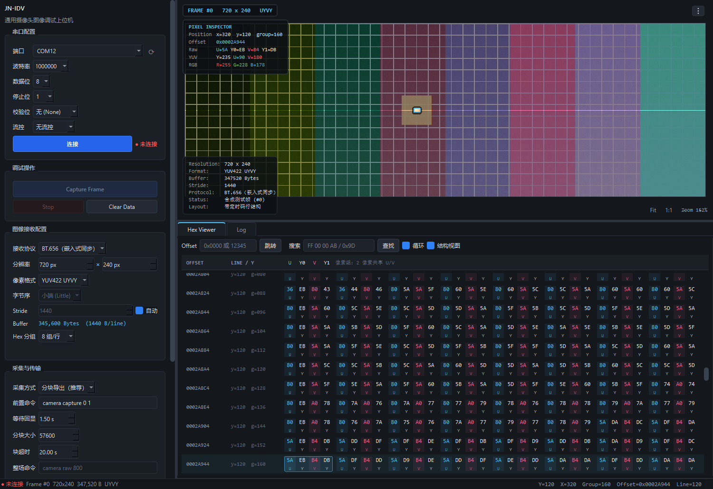
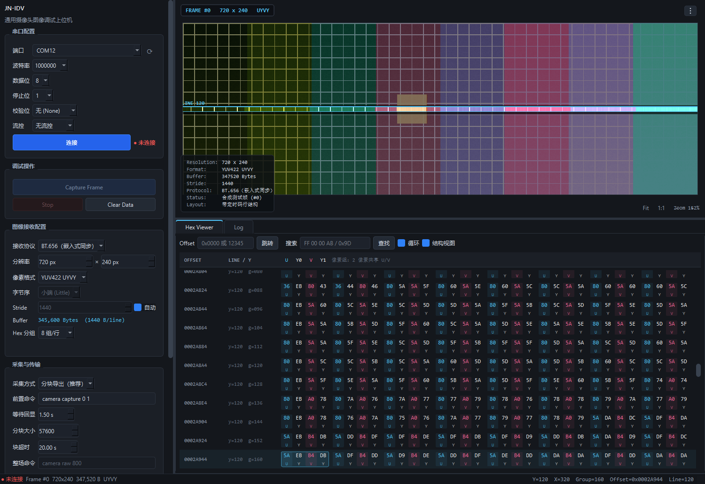
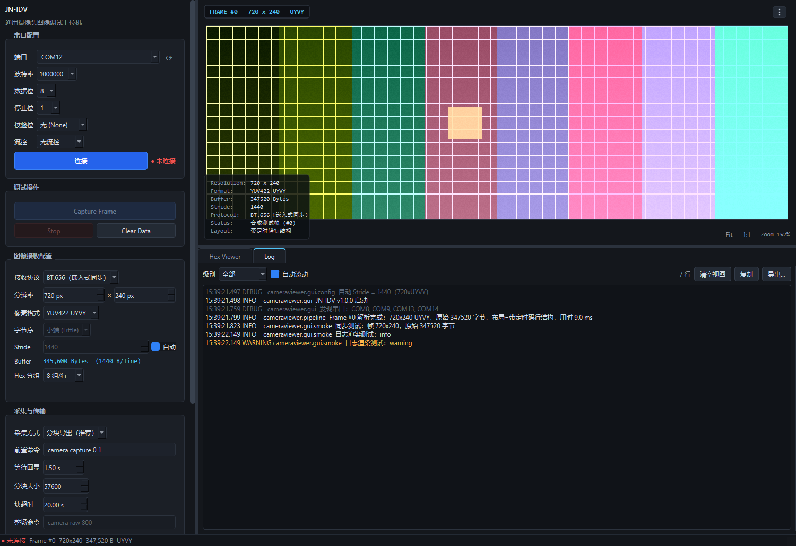

# JN-IDV · Camera Image Debug Viewer

[English](README.md) | 简体中文

> **JN-IDV** 既是仓库名也是程序名（Image Debug Viewer 的缩写）；完整描述性名称是 Camera Image Debug Viewer。窗口标题、日志启动行与 CLI 头部统一使用 `JN-IDV`。

通用嵌入式摄像头图像调试上位机。当前内置 BT.656 / YUV422 的采集与解析链路，面向「串口下发命令 → 设备回传原始 Buffer → 解析成图像 → 逐行逐像素分析」这类调试场景。

**它不是普通串口助手，也不是普通摄像头预览软件**：它把原始字节、BT.656 行结构、像素组和最终图像建立准确的坐标关联。串口收包、图像解码、Hex 组织、文件导出全部在 `core/` 中，GUI 与 CLI 共用。




## 1. 功能概览

| 能力 | 说明 |
|---|---|
| 串口配置 | 端口扫描 / 手动输入、波特率、数据位、停止位、校验位、流控；连接失败显示真实原因 |
| 图像参数 | 协议、宽高、像素格式（UYVY / YUYV / YVYU / VYUY / RGB565 / RGB888 / JPEG）、Stride、Byte Order、Buffer 大小、Hex 分组 |
| 采集流程 | `Capture Frame` 一键采集；分块导出（默认 57600 B/块）或整场命令；可 Stop、超时、CRC/长度校验、分块拼帧 |
| Image Preview | 自适应 / 1:1 / 滚轮缩放、最近邻放大、像素检查器；行级与像素组级「抽出放大」动画 |
| Hex Viewer | 按行 / SAV / EAV / 像素组展示；U/Y/V 分色；Offset 跳转、十六进制搜索、复制、结构化 / 纯 Hex 切换 |
| 双向联动 | 鼠标在 Hex 中移动 → 图像对应整行或像素组实时突出；鼠标在图像上移动 → Hex 自动定位并高亮 |
| 导出 | 右上角统一三点菜单：PNG、JPG、原始 Buffer、结构化 Hex、帧元数据 JSON、完整调试会话 |
| 下位机示例代码 | 菜单里一键复制 / 导出按当前参数生成的 C 源码与头文件（通用 UART 分块上传帧格式） |
| Log | 真实 `logging` 日志（文件 + 界面同源），级别过滤、暂停自动滚动、复制、导出 |
| CLI | Agent 自动化：采集、离线解码、结构分析、Hex 导出、生成示例代码、合成测试数据 |
| 扩展架构 | 新增像素格式 / 采集协议 / 数据展示格式不需要改 GUI 主体 |

## 2. 快速开始

### 2.1 环境

```powershell
conda activate kbhost
cd JN-IDV                       # 或本地实际的检出目录名
python main.py
```

在其他机器上重新安装依赖：

```powershell
pip install -r requirements.txt
# 可选：解码 JPEG 时如果没有 Qt，可安装 Pillow
pip install pillow
```

### 2.2 首次采集

1. 左侧「串口配置」选择端口和波特率（默认 `1000000`）。
2. 点「连接」，状态栏变绿。
3. 确认「图像接收配置」：宽高、像素格式、Stride、Buffer 大小。
4. 在「采集与传输」中填写本设备的实际命令：
   - 前置命令示例：`camera capture 0 1`
   - 分块导出模板：`camera dump {off} {len}`
   - 整场命令示例：`camera raw 800`
   > 这些只是占位示例。不同设备的命令不同，直接在界面里改成实际命令即可，会保存在本机配置中。配套的固件侧已注册 `camera capture` / `camera dump` / `camera raw` / `camera info` 这组通用命令。
5. 点「调试操作 → Capture Frame」。
6. 采集流程：
   - 执行前置命令让设备采集一帧；
   - 按 `57600` 字节分块发送导出命令；
   - 每块校验 64 字节头、CRC32、4 字节尾，按 `total/offset` 拼回整场；
   - 解析 BT.656 布局、解码像素格式、生成 `Frame`；
   - Image Preview 显示真实图像，Hex Viewer / Log 同步可用。

也可以不用板子：右上角菜单 →「加载原始 Buffer (.bin)…」，或直接把 `.bin` 文件拖进窗口。

### 2.3 交互速查

- Image Preview：滚轮缩放（以光标为中心）、拖拽平移、双击适应窗口；右下角 `Fit` / `1:1` / `−` / `+`。
- Hex Viewer：鼠标悬停行 → 图像整行突出；悬停具体像素组/字节 → 图像对应像素组突出，并显示 Pixel Inspector。
- 图像上移动鼠标 → Hex 自动滚动到对应行并高亮；单击像素 → Hex 保持该像素组选中。
- Hex 工具栏：`Offset` 跳转、`搜索`（如 `FF 00 00 AB`，支持 `0x`、空格、逗号）、`循环`、`结构视图` 开关。
- Hex 右键：复制当前像素组字节 / 当前行 Hex / 当前行 C 数组 / Offset / 行信息 / 搜索此字节。
- 右上角三点菜单：所有导出与「下位机示例代码」入口。

## 3. 界面

右侧数据显示区采用上下分布：

- **上半部分**：单独的 Image Preview，始终可见；
- **下半部分**：Hex Viewer / Log 两个页签；
- 中间的分隔条可以上下拖动，调整图像和 Hex 的高度（比例会自动记忆）。


### 3.1 Image Preview



- 原始图像层始终不变；行/像素高亮只是绘制层，不会修改 `frame.image` 或 `frame.raw_data`。
- 行级高亮：其他区域压暗，当前行按动画放大并轻微外扩，带阴影和边框。
- 像素组高亮：整行恢复正常亮度，当前 YUV422 宏像素组（2 像素共享 U/V）单独放大，并用细线区分两个亮度像素。
- 左下角状态：Resolution / Format / Buffer / Stride / Protocol / Status / Layout，全部来自真实 `Frame`。
- 像素级高亮时左上角出现 Pixel Inspector：Position、Buffer Offset、Raw U/Y/V 字节、YUV、RGB。

### 3.2 Hex Viewer


- 按 `LINE → SAV → Pixel Group → EAV` 组织；没有定时码时自动按 Stride 切行，并在 Log / 行信息中说明。
- 每个字节格显示十六进制值和分量字母；U 青色、Y 白色、V 粉色、SAV/EAV 橙色。
- 像素组按 `U0 Y0 V0 Y1` 四格一组显示，明确表示 U/V 由相邻两个像素共享，不会把两个像素误当成两组完整 YUV。
- 行头显示行号、有效/消隐、Field、数据长度、对应图像行；行尾显示 `image row N`。
- 缓冲内若有漏进采集缓冲的定时码，会在对应 offset 单独显示，不会混进像素组。

### 3.3 Log



- 与 `core.log` 共用同一个 `logging` 源：串口参数、TX/RX、接收进度、字节数、完整性判断、解析耗时、导出记录、异常都在这里。
- 界面「清空视图」只清显示，不破坏文件日志与底层 logging。
- 支持级别过滤、暂停自动滚动（取消勾选）、复制、导出 `.txt`。
- 日志文件在 `logs/camera_viewer_YYYYmmdd_HHMMSS.log`。

## 4. 串口协议

上位机使用通用的「64 字节头 + payload + 4 字节尾」分块上传格式，具体字段如下。设备侧只需按此格式回复即可；命令本身由用户在界面配置，工具不绑定任何设备。

```text
offset  size  field
0       4     sync = A5 5A A5 5A
4       1     ver = 1
5       1     flags（bit0 raw / bit1 interlaced / bit2 PAL / bit3 短帧）
6       2     hdr_len = 64
8       4     state0   设备状态快照 0（可选，可填 0）
12      4     state1   设备状态快照 1
16      4     state2   设备状态快照 2
20      4     state3   设备状态快照 3
24      4     state4   设备状态快照 4
28      4     total    整场字节数
32      4     offset   本包在整场中的偏移
36      4     length   本包 payload 长度
40      4     ms
44      4     flags2
48      4     crc_hdr = CRC32(bytes[8..47])
52      4     crc_data= CRC32(payload)
56      8     reserved
64      N     payload
64+N    4     tail = 5A A5 5A 5A
```

`crc32` 为标准 CRC-32（poly `0xEDB88320`，与 `zlib.crc32` 等价）。

`state0..state4` 只用于展示诊断，不参与解析。设备侧可以全部填 0。

### 4.1 采集状态机

```text
用户点击 Capture Frame
  → CaptureWorker(QThread)
  → CaptureEngine.run()
      → 如果配置了 prepare：发送前置命令，等待回显并检测失败关键字
      → 分块模式：发送 dump 命令，FrameParser 增量解析
      → 每块校验 offset/length/total/CRC/TAIL，不一致立即报错
      → 全部收齐后拼接为完整 payload
  → build_frame()：BT.656 布局 + 有效行提取 + 像素格式解码
  → build_structured()：按行/像素组组织 Hex 显示数据
  → 主线程收到 (Frame, StructuredData)，更新上方图像与下方 Hex / Log
```

关键保证：

- 串口一次 `read()` 绝不会被当成完整图像；必须由 `FrameParser` 找到合法帧。
- 上一帧的残留数据不会混入下一帧：每块发送前 `reset_input_buffer()`，解析器每块重置。
- 采集期间 Capture 按钮禁用；Stop 通过 `threading.Event` 通知，每 50 ms 检查一次。
- 超时、长度异常、CRC 错、串口断开都会带真实原因写入 Log 并弹窗。

## 5. 目录结构

```text
JN-IDV/
├── main.py                     # GUI 入口
├── cli.py                      # CLI 入口（Agent 自动化）
├── requirements.txt
├── README.md                   # 默认说明（英文）
├── README_zh.md                # 中文说明（本文件）
├── SKILL.md                    # 给后续 Agent / 二次开发者的操作手册
├── core/                       # 与 Qt 无关的核心业务
│   ├── config.py               # SerialConfig / ImageConfig / CaptureConfig
│   ├── log.py                  # logging 初始化
│   ├── protocol/               # 通用 64B 帧协议、增量解析、协议注册表
│   ├── serial/                 # pyserial 封装、端口枚举
│   ├── acquisition/            # 采集引擎（分块 / 整场 / 取消 / 超时）
│   ├── formats/                # 像素格式定义、BT.656 布局与坐标映射
│   ├── image/                  # Frame 对象、各像素格式解码器
│   ├── hex/                    # 结构化 Hex 数据组织（DataFormatter）
│   ├── export/                 # PNG/JPG/Raw/Hex/Metadata/Session 导出
│   ├── device_template.py      # 下位机上传 C 代码生成
│   └── pipeline.py             # Buffer → 布局 → 解码 → Frame 流水线
├── gui/
│   ├── main_window.py
│   ├── theme.py                # 深色主题
│   ├── focus.py                # ViewFocus（图像/Hex 共用坐标对象）
│   ├── log_bridge.py           # logging → Qt 信号
│   ├── panels/
│   │   ├── config_panel.py
│   │   ├── image_viewer.py
│   │   ├── hex_viewer.py
│   │   ├── log_viewer.py
│   │   └── export_menu.py
│   └── workers/                # CaptureWorker / BuildFrameWorker / CommandWorker
├── tests/                      # 82 个 unittest + GUI 冒烟测试
├── docs/screenshots/           # README 截图
├── out/                        # 默认导出目录（运行时生成内容）
└── logs/                       # 日志文件（运行时生成）
```

## 6. 架构与数据流

```text
                    ┌─────────────────────────────┐
                    │          core/              │
                    │  serial → protocol →        │
                    │  acquisition → pipeline →   │
                    │  decoders / bt656 / hex     │
                    │  export / device_template   │
                    └──────────┬──────────────────┘
                               │
              ┌────────────────┴────────────────┐
              │                                 │
        ┌─────▼─────┐                     ┌─────▼─────┐
        │    GUI    │                     │    CLI    │
        │ 人工调试   │                     │ Agent 调试 │
        └───────────┘                     └───────────┘
```

三层职责：

1. **数据采集协议**：`core.protocol` + `core.acquisition` —— 怎么让设备发数据、怎么判断一帧完整。
2. **图像数据格式**：`core.formats.bt656` + `core.image.decoders` —— 同步结构、有效区域、像素格式解码。
3. **原始数据展示格式**：`core.hex.formatter` —— 把 Buffer 组织成行/像素组，GUI 只负责画。

`Frame` 统一保存：完整原始 Buffer、解码后的 RGB、亮度/YUV 平面、宽高、格式、协议、帧序号、时间戳、协议头、解析参数、BT.656 布局与坐标映射。原始 Buffer 在图像解析后**不会丢弃**。

## 7. 坐标映射

BT.656 原始数据里可能有 SAV/EAV、消隐区和行尾填充，因此不能简单用 `offset = (y*width + x)*bpp`。

本项目由 `BT656Layout` 负责：

- `layout.locate(offset)`：Buffer 偏移 → `PixelLocation(offset, y, x, group, component, ...)`
- `layout.offset_of(x, y, component)`：像素/分量 → Buffer 偏移
- 行起点、行长、有效宽度都来自真实解析结果（`codes` 模式用 SAV/EAV 划分，`uniform` 模式按 Stride）
- 行尾填充、行间间隙、SAV/EAV 字节都有明确标记，不会映射成像素

GUI 的联动全部通过 `ViewFocus` + `layout` 计算，动画只改变绘制矩形，不参与坐标，所以缩放/动画不会让高亮位置漂移。

## 8. 右上角三点菜单

位置固定在右侧数据显示区右上角（悬浮在 Image Preview 上方），Hex Viewer / Log 页面同样可用。

| 菜单项 | 内容 |
|---|---|
| 保存图像为 PNG | 当前解码后的 RGB 图像 |
| 保存图像为 JPG | 同上，质量 95 |
| 导出原始 Buffer | 设备实际发送的完整 payload（不含 64B 协议头） |
| 导出结构化 Hex | 带 LINE / SAV / 像素组注释的文本（UTF-8 BOM，CRLF） |
| 导出帧元数据 | JSON：配置、协议头、布局摘要、耗时、告警 |
| 保存调试会话 | 目录内一次写入 raw.bin + PNG + Hex + metadata.json + 日志 + 下位机示例代码 |
| 复制 C 源码到剪贴板 | 按当前图像/串口参数生成，可直接粘贴 |
| 导出 C 源码 (.c) | `camera_upload.c` |
| 导出 C 头文件 (.h) | `camera_upload.h` |
| 加载原始 Buffer (.bin) | 离线解析，也支持拖拽文件到窗口 |

没有成功采集/加载帧时，图像/Raw/Hex/元数据/会话导出会自动禁用。

## 9. 下位机示例代码

菜单 →「下位机上传示例代码」→ 复制或导出。生成内容使用通用 UART 分块上传帧格式，并把当前上位机参数写成宏：

```c
#define CAM_UP_WIDTH                720
#define CAM_UP_HEIGHT               240
#define CAM_UP_STRIDE               1440
#define CAM_UP_PAYLOAD_BYTES        345600
#define CAM_UP_DEFAULT_CHUNK        57600
#define CAM_UP_BAUDRATE             1000000
```

生成文件包含：

- CRC32、64 字节头组帧、`rt_device_write` 循环写满、payload、尾字节；
- MSH 命令 `cam_up [off] [len]` / `cam_up cap [ms]`；
- 三个 `RT_WEAK` 板级钩子，粘贴到工程后按板级实现：
  - `cam_up_capture(ms)`：触发一次采集；
  - `cam_up_get_buffer(&total)`：返回缓冲区与总长度；
  - `cam_up_get_state(&state0..4)`：填写状态快照（可全 0）。

更详细的协议说明直接写在生成文件头注释里。

## 10. CLI（Agent / 自动化）

GUI 与 CLI 共用全部核心模块，不与 GUI 互相依赖。

```bash
python cli.py list-ports
python cli.py info --port COM12 --baud 1000000
python cli.py send --port COM12 -c "camera info" -c "camera capture 1000"

# 采集 + 保存原始 Buffer + PNG
python cli.py capture --port COM12 --out cap.bin --png cap.png

# 离线解码 / 分析 / Hex
python cli.py decode --input cap.bin --out cap.png
python cli.py analyze --input cap.bin
python cli.py hex --input cap.bin --out cap_hex.txt

# 生成下位机示例代码
python cli.py device-code --out camera_upload.c

# 生成合成测试 Buffer（仅离线验证，不是设备采集）
python cli.py gen --out out/synthetic.bin --codes
```

常用参数：

| 参数 | 默认值 | 说明 |
|---|---|---|
| `--port` / `--baud` | `COM12` / `1000000` | 串口 |
| `--mode` | `chunked` | `chunked` 分块 / `whole` 整场单命令 |
| `--prepare` | `camera capture 0 1` | 采集前置命令，`""` 表示不执行 |
| `--chunk` | `57600` | 分块大小 |
| `--timeout` | `20` | 每块超时秒数 |
| `--width/--height` | `720/240` | 分辨率 |
| `--format` | `UYVY` | 像素格式 |
| `--stride` | `1440` | 每行字节数，`0` = 自动 |
| `--groups-per-row` | `8` | Hex 每行像素组数 |

> 默认命令均为占位示例，实际设备命令请通过命令行参数或界面配置。

退出码：`0` 成功，`1` 采集/解析/导出失败，`2` 参数或依赖错误，`130` 中断。

## 11. 测试与验证

```powershell
# 核心单元测试（82 个）
python -m unittest discover -s tests -p "test_*.py"

# GUI 冒烟测试（离屏，可无显示器）
python tests/gui_smoke.py

# 生成带系统字体的界面截图（窗口会移到屏幕外）
python tests/gui_smoke.py --native

# 指定截图窗口尺寸（逻辑像素 WxH，README 截图用的是 1500x1030）
python tests/gui_smoke.py --native --size 1500x1030
```

覆盖内容：

- 协议：逐字节解析、噪声/伪 SYNC/坏 CRC 恢复、双帧、诊断文本；
- BT.656：带/不带定时码布局、消隐行、行尾填充、截断、坐标双向映射、打包提取；
- 解码：UYVY / YUYV / YVYU / VYUY 与 BT.601 公式逐像素一致、RGB565 大小端、RGB888、JPEG；
- Hex：显示行完整覆盖整个 Buffer、像素组切分、Offset 查找、纯 Hex 模式；
- 采集：分块拼帧、块长度裁剪、整场模式、前置命令失败、offset 不匹配、取消、超时；
- 导出：PNG/JPG 可回读、Raw 与输入逐字节一致、Hex/JSON/会话文件、非法图像报错；
- 配置与代码生成：自动 Stride、Buffer 大小、校验告警、生成 C/H 内容与参数一致。

本次开发环境的 GUI 冒烟测试已通过，截图见 `docs/screenshots/`。由于没有连接实际设备，真实串口采集需要在目标硬件上复验。

## 12. 二次开发

### 12.1 新增像素格式

1. 在 `core/formats/pixel_formats.py` 增加 `PixelFormat` 描述（`kind`、`bytes_per_pixel`、`lane_components`、`group_bytes`）。
2. 在 `core/image/decoders.py` 实现 `ImageDecoder.decode()` 并注册到 `DECODERS`。
3. 在 `core/config.py` 的 `resolve_stride()` 规则中确认宽度→Stride（`bytes_per_pixel` 已覆盖大部分情况）。
4. Hex Viewer / 图例 / Pixel Inspector 会自动使用新格式的 lane 定义。

### 12.2 新增采集协议

1. 实现 `core/protocol/base.py` 的 `CaptureProtocol`：
   - `prepare_commands()`、`dump_command()`、`whole_command()`、`new_parser()`、`validate_packet()`；
2. 用 `@register_protocol` 注册，并把 key 加入 `core.config.PROTOCOLS`；
3. 在 `core/formats/` 增加对应布局解析（参照 `bt656.py`）；
4. 在 GUI 的 `PROTOCOL_FUTURE` 中移除占位项即可，主界面不需要改。

### 12.3 新增展示格式

实现 `core.hex.formatter.DataFormatter` 的 `format(frame, groups_per_row)`，输出 `StructuredData(rows=[HexRow...])`。GUI 的 Hex Viewer 只认识 `HexRow` 的 `kind/offset/length/groups/image_row/line_index`，不需要为每种协议写新的绘制代码。

## 13. 已知限制 / 待验证

- **真实硬件未在本次开发环境连接**：串口采集流程已用 FakeTransport 单元测试覆盖（分块、CRC、超时、取消），但最终仍需在目标硬件上复验。
- **单场行数可能少于配置值**：工具会按实际 Buffer 切行并在 Log/告警中说明；界面显示的是真实行数。
- **定时码两种形态**：采集接口正常会吃掉 SAV/EAV（Stride 模式）；若定时码漏进缓冲，会显示为 sync 行。若码字分布不规律，布局会回退到 Stride 模式，不会用错误行结构强行解析。
- **JPEG**：尺寸来自码流本身，没有逐像素 Buffer 映射；Image Preview 可用，Hex 的像素组联动不适用（会显示纯字节行）。
- **JPEG 解码**：优先 Pillow，没有 Pillow 时用 Qt；纯命令行环境若都没有会报错并提示安装。
- **导出 JPG**：需要 Qt 或 Pillow；PNG 只用标准库。
- **DVP / MIPI / SPI Camera**：仅预留协议注册与 UI 占位，本次未实现。
- **连续预览**：当前按「一次命令采集一帧」工作，不做连续视频流；需要连拍时可多次 Capture 或在 CLI 中循环调用。
- **Hex 内存**：结构化行只保存元信息（约 1 万个小对象/帧），不复制每个字节；但一次加载超大 JPEG 等仍受 Python 内存限制。
- **字体**：离屏无头环境可能没有系统字体（Qt 会打印 `Cannot find font directory`），文字可能显示为方框；在 Windows 桌面正常启动即可。`tests/gui_smoke.py --native` 可使用系统字体生成截图。

## 14. 与需求验收项对应

| 需求 | 实现位置 |
|---|---|
| GUI 独立启动 | `main.py` |
| 串口配置 / 连接 / 断开 | `gui/panels/config_panel.py` + `core/serial/transport.py` |
| 采集指令 / 完整接收 / 拼帧 | `core/acquisition/capture.py` + `core/protocol` |
| BT.656 解析 | `core/formats/bt656.py` |
| 图像预览 | `gui/panels/image_viewer.py` |
| PNG / JPG / Raw | `core/export/exporter.py` + `gui/panels/export_menu.py` |
| 结构化 Hex / 像素分组 / Offset | `core/hex/formatter.py` + `gui/panels/hex_viewer.py` |
| 行级 / 像素级 / 字节级 / 同步码联动 | `ViewFocus` + `ImageViewer` + `HexViewer` |
| 动画不改原始数据 | 绘制层独立，`Frame` 只读 |
| Log | `core/log.py` + `gui/panels/log_viewer.py` |
| CLI | `cli.py` |
| 扩展接口 | `CaptureProtocol` / `ImageDecoder` / `DataFormatter` |
| 下位机示例代码 | `core/device_template.py` + 三点菜单 |

## 15. 相关文件

- GUI 入口：`main.py`
- CLI 入口：`cli.py`
- 核心流水线：`core/pipeline.py`
- 协议与采集：`core/protocol/`、`core/acquisition/`
- 测试：`tests/`

## 16. 许可

遵循仓库上级目录的许可与 SPDX 约定；生成的 C 示例代码可直接用于目标板级工程。
